# Model Card — «АнтиСпам и Кликбейт»: распознавание спам-сообщений и кликбейт-заголовков (RU, v1.0)

> Формат: **Google Model Cards Toolkit** (Markdown), расширенный блоками
> «Цель модели · Метрики · Ограничения · Bias/Fairness )
> и сквозной трассировкой по этапам жизненного цикла модели:
> **Разработка → Валидация → Утверждение → Деплой → Мониторинг → (СД) Retrain**,
> с обязательным **human-in-the-loop (ручное подтверждение перед продом)**.
>
> Первоисточники: `model.ipynb`, `df.csv`.

---

## 0. Паспорт модели (Model Details)

| Поле | Значение |
|---|---|
| **Имя модели** | `spam_clickbait_classifier_ru` |
| **Версия** | **1.0** — *champion* («Модель 2» из `model.ipynb`) |
| **Тип задачи** | Многоклассовая классификация текста, 3 класса (0 — обычное, 1 — спам, 2 — кликбейт) |
| **Архитектура** | `FeatureUnion`: TF‑IDF word (1–2‑gram, `min_df=3`, `max_features=30 000`, `sublinear_tf=True`) + TF‑IDF `char_wb` (3–5‑gram, `min_df=3`, `max_features=30 000`) → `LogisticRegression(C=10.0, class_weight='balanced', max_iter=1000, solver='lbfgs')`. Всего **60 000 признаков** |
| **Вход** | Текст сообщения на русском языке (для продуктового контура — расшифровка голосового сообщения, STT-транскрипт) |
| **Выход** | Вектор вероятностей `P0, P1, P2` + метка `argmax` + уровень уверенности |
| **Дата обучения / дата карты** | 01.10.2026 / 12.10.2026 |
| **Владелец модели** | DS‑команда (Data Science) |
| **Бизнес‑владелец** | Владелец продукта «Приложение» — руководитель направления, отвечающий за процесс «Обработка входящих голосовых сообщений и звонков» |
| **Статус** | **Кандидат в пилот (этап 04 «Деплой», ограниченный контур).** Валидация‑1 (офлайн, `df.csv` v1) пройдена. **Валидация‑2 на целевой выборке (транскрипты реальных голосовых сообщений) — не проводилась**, см. §7.6 |
| **Связанные документы** | `model.ipynb`, `df.csv`, `Model_BPMN.md` (BPMN эксплуатации), `Model_retrain_BPMN.md` (BPMN переобучения). |

### 0.1. Где модель находится в жизненном цикле

| Этап (слайд 1) | Содержание | Статус | Артефакт |
|---|---|---|---|
| 01 **Разработка** | Постановка задачи, сбор и профилирование данных, обучение и сравнение моделей | завершён | `model.ipynb`, `df.csv` |
| 02 **Валидация** | Метрики на отложенной выборке, проверка границ применимости, fairness‑анализ | пройдена частично: офлайн‑выборка, целевой домен (голос) | §6, §7, §8 |
| 03 **Утверждение** | **Human‑in‑the‑loop:** подпись бизнес‑владельца и риск‑функции | не получено | §0.3 |
| 04 **Деплой** | Упаковка модели в мобильное приложение, canary 5–10 % | подготовлено, не запущено | §6.4 (раздел «Интеграция с SAS») |
| 05 **Мониторинг** | Дрейф, качество по обратной связи, доля «серой зоны», SLA | начнётся вместе с пилотом | `Model_BPMN.md`, шаг T11 |
| **СД Retrain** | Переобучение по триггеру | триггеры определены | `Model_retrain_BPMN.md` |

### 0.2. Ключевые числа

| | Значение |
|---|---|
| Обучение / тест | 78 514 / 19 629 сообщений (80/20, `stratify`, `seed=42`) |
| Accuracy (тест) | **0,9452** |
| F1‑weighted / F1‑macro | **0,9455** / **0,9354** |
| ROC‑AUC (OvR, weighted) | **0,9892** |
| F1 по классам | обычное 0,9564 · спам 0,9674 · кликбейт 0,8823 |
| Доля автоматических решений при пороге 0,60 | **97,36 %** (человеку остаётся ≈ 4,4 %) |
| Размер модели (pickle, float64) | см. §6.6 |
| Время классификации одного сообщения | см. §6.6 |

### 0.3. Кто должен подписать карту

| Роль | ФИО | Подпись | Дата |
|---|---|---|---|
| Владелец модели (DS lead) | \_\_\_\_\_\_\_\_\_\_\_\_ | \_\_\_\_\_ | \_\_\_\_ |
| Бизнес‑владелец процесса (продукт) | \_\_\_\_\_\_\_\_\_\_\_\_ | \_\_\_\_\_ | \_\_\_\_ |
| Риск‑функция / комплаенс | \_\_\_\_\_\_\_\_\_\_\_\_ | \_\_\_\_\_ | \_\_\_\_ |
| MLOps (владелец мониторинга) | \_\_\_\_\_\_\_\_\_\_\_\_ | \_\_\_\_\_ | \_\_\_\_ |

>
---

## 1. Цель модели (бизнес‑задача)

### 1.1. Что делает модель

Модель **однозначно относит входящее сообщение к одному из трёх классов**:

| Метка | Класс | Бизнес‑смысл |
|---|---|---|
| `0` | **Обычное** | Легитимное сообщение от человека — его нужно показать и дать прослушать |
| `1` | **Спам** | Рекламная рассылка, мошенническая «банковская» атака, автоинформатор, массовая рассылка — входящее, но **не требует внимания** |
| `2` | **Кликбейт** | Заманчивый заголовок/обещание, цель которого — заставить открыть/перейти/ответить — **требует осознанного решения** |

Вход — один текст. Выход — три вероятности и итоговая метка.

### 1.2. Зачем это нужно (продуктовый контекст)

Финальный продукт проекта — **мобильное приложение, устанавливаемое на смартфон**,
классифицирующее **аудио‑сообщения**, поступающие **телефонным звонком** или через
**мессенджеры (Telegram, WhatsApp, VK, MAX и другие)**.

Проблема, которую решает модель: пользователь смартфона получает поток входящих
голосовых сообщений и вынужден **прослушивать каждое**, чтобы понять, что это:

* рекламная рассылка или автоинформатор — **время потрачено впустую**;
* мошенническое «ваш счёт заблокирован, продиктуйте код» — **риск хищения денег**,
  причём время на осознание уходит на прослушивание;
* обычное личное сообщение — **его легко пропустить** среди шума.

Модель — это **автоматический первичный фильтр** перед пользователем.

### 1.3. Место в бизнес‑процессе

**Бизнес‑процесс:** «Обработка входящих голосовых сообщений и звонков»
(детализация — в `Model_BPMN.md`).

Модель встроена в поток на шаге **скоринга** (T03) и является тем шагом,
который **заменяет сплошное прослушивание** выборочным:

```
Входящий звонок / голосовое  →  [T01 приём]  →  [T02 STT + очистка]  →  [T03 СКОРИНГ МОДЕЛЬЮ]
                                                                             ↓
                                                              P0 / P1 / P2 + метка
                                                                             ↓
   ┌───────────────────────────────┬──────────────────────────┬──────────────────────────┐
   ↓                               ↓                          ↓                          ↓
[0 Обычное → уведомить]   [1 Спам → свернуть,      [2 Кликбейт → пометить,     [серая зона →
                            без звука]              «реклама/кликнуть?»]         показать + спросить]
                                                                             ↓
                                                              [прослушивание пользователем]
                                                                             ↓
                                                       [обратная связь: метка пользователя]
```

### 1.4. Почему здесь целесообразно использовать ML, а не правила)

| Критерий | Правила / «чёрный список» | Модель |
|---|---|---|
| Скорость ответа | секунды–минуты на обновление правил | **мгновенно**, правила не нужны |
| Объём лексики спама | бесконечен, меняется ежедневно | модель обобщает шаблоны и не требует правки на каждый новый текст |
| Контекст | правила не видят контекста сообщения | char‑n‑граммы ловят опечатки, сленг, склейки слов — типичные для голосовых (STT) |
| Стоимость владения | растёт с каждым новым типом мусора | переобучение по триггеру — автоматизируемый процесс (`Model_retrain_BPMN.md`) |
| Смещение правил | каждая новая строка — потенциальная ложная блокировка | порог уверенности даёт управляемую точку баланса «пропустить / показать» |

### 1.5. Экономический эффект: за счёт чего

> Цифры в денежном выражении в карте **намеренно не приводятся** — они зависят от
> тарифа оператора связи, стоимости минуты эфира и модели тарификации продукта.
> Ниже — **механизм** эффекта, выраженный через измеренные метрики модели.

1. **Экономия времени пользователя на «мусорный» трафик.**
   Модель в 97,4 % случаев принимает решение сама (порог 0,60). Из них около 95,6 %
   закрываются без участия человека. Прослушивать приходится лишь единицы процентов
   входящих — вместо всего потока.

2. **Снижение ущерба от мошенничества (класс «спам»).**
   Recall по спаму — **0,9632**: модель находит 96,3 % мошенническо‑рекламных сообщений.
   Основной ущерб предотвращается не точностью метрики, а **скоростью**: предупреждение
   «Это, скорее всего, мошенничество» приходит сразу при поступлении, до того как
   пользователь начнёт диктовать коды. Здесь ценно именно то, что показывается
   **заголовок и предупреждение, а не прослушивание целиком**.

3. **Снижение репутационного и правового риска от кликбейта (класс 2).**
   Recall 0,9001 + Precision 0,8652; оставшийся «сомнительный» диапазон
   (0,60 ≤ P₂ < 0,80, ≈ 1,8 % потока) выносится под **осознанное решение человека** —
   именно там, где цена ошибки максимальна.

4. **Не потерять обычные сообщения.** Recall по обычным — **0,9522**, то есть
   ошибка на «полезном» трафике 4,78 % против практически нулевого у человека,
   который просто слушает всё подряд. Это и есть тот барьер, который делает
   автоматизацию допустимой.

5. **Снижение стоимости эксплуатации и поддержки правил.**
   Нет команды, которая вручную пишет и поддерживает список стоп‑слов;
   качество поддерживается циклом мониторинга и переобучения.

6. **Снижение риска для репутации продукта.** Решение журналируется с версией модели,
   пользователь может оспорить метку, а обратная связь становится **размеченными
   данными** для следующей версии — модель со временем «доучивается» на реальном
   трафике, которого не было в обучающей выборке.

---

## 2. Версия данных и описание датасета

### 2.1. Карточка набора данных `df.csv` v1

| Характеристика | Значение | Комментарий |
|---|---|---|
| Файл | `df.csv`, версия **v1** | Версия и хэш фиксируются в Git; любое обновление → триггер переобучения |
| Структура | **133 317 строк × 2 столбца** | `text` (текст, RU), `is_spam1_or_clickbait2` (метка 0/1/2) |
| Пропуски | **0** | — |
| «Битые» строки при загрузке | **0** | загрузчик `load_fixed_csv` разбирает строки по последнему разделителю |
| Полные дубликаты (сырые) | **35 174 (26,4 %)** | удалены; причина — шаблонные SMS и повторяющиеся заголовки |
| Рабочий набор после дедупликации | **98 143** строки | — |
| Длина текста | среднее **468** симв., медиана **84**, макс. **5 718**, мин. **0** | сильно правоскошенное распределение: длинные новостные заголовки + короткие SMS |
| Происхождение | Смесь переводных SMS‑корпусов (спам / легальные) **и** новостных заголовков (кликбейт / обычные) | два разнородных источника собраны в один файл |
| Двойная разметка | **не проводилась** |️качество меток не измерено |
| Дата размечения | не зафиксирована в данных | невозможно оценить объективно |

### 2.2. Распределение классов

| Класс | До дедупликации | % | После дедупликации | % |
|---|---:|---:|---:|---:|
| 0 — обычное | 78 218 | 58,7 % | **59 255** | **60,4 %** |
| 1 — спам | 21 502 | 16,1 % | **21 314** | **21,7 %** |
| 2 — кликбейт | 33 597 | 25,2 % | **17 574** | **17,9 %** |
| **Итого** | **133 317** | 100 % | **98 143** | 100 % |

> 

### 2.3. Разбиение на выборки

| Выборка | Размер | Состав по классам (0 / 1 / 2) |
|---|---:|---|
| Train | **78 514** | 47 404 / 17 051 / 14 059 |
| Test (отложенный) | **19 629** | 11 851 / 4 263 / 3 515 |
| Кросс‑валидация | `StratifiedKFold(n_splits=3, shuffle=True, random_state=42)` | пропорции сохраняются в каждом фолде |

Разделение — `train_test_split(test_size=0.2, random_state=42, stratify=y)`.
**Случайное, а не временное** — прямое следствие отсутствия даты в данных (§2.1).

### 2.4. Предобработка текста `clean_text` (шаг за шагом)

Ровно та же функция, что в `model.ipynb`. Любое отклонение ломает соответствие
метрик этой карте — поэтому функция версионируется вместе с моделью.

| # | Операция | Регулярное выражение / код | Зачем |
|---|---|---|---|
| 1 | Удаление HTML‑тегов | `<[^>]+>` → пробел | мусор разметки |
| 2 | Нормализация URL | `https?://\S+\|www\.\S+\|<link>` → токен `URL` | все ссылки схлопываются в один признак |
| 3 | Удаление упоминаний | `[@#]\w+` → пробел | @‑хендлы и #‑теги |
| 4 | Приведение к нижнему регистру | `text.lower()` | естественно для STT: транскрипт не имеет регистра и пунктуации |
| 5 | Нормализация «ё» | `ё` → `е` | убирает ошибки распознавания речи («её» / «ее») |
| 6 | Маскирование чисел | `\d+([.,]\d+)?` → токен `NUM` | суммы, телефоны, коды не перегружают словарь |
| 7 | Удаление всех небуквенных символов | `[^a-zA-Zа-яА-Я\s]` → пробел | **убивает пунктуацию, эмодзи, CAPS‑акцент** |
| 8 | Сжатие пробелов | `\s+` → пробел, `.strip()` | — |

* Время обработки всего корпуса: **≈ 3,7 с**.
* После очистки **4 записи** в train‑выборке оказались пустыми (состоят только из
  цифр/символов). `model.ipynb` их **не удаляет** — на таких записях модель работает
  только по свободному члену и почти наверняка относит их к «обычным».
  Это дефект качества данных; при переобучении такие строки следует удалять (шаг R06).

### 2.5. Что в данных **нет** (критично для границ применимости)

Ни один из перечисленных столбцов **отсутствует** в `df.csv`:

| Отсутствующий параметр | Почему это важно | Какой дефект он вызывает |
|---|---|---|
| **Дата/время сообщения** | нельзя сделать временное разбиение и замерить concept drift | метрики **оптимистично завышены** относительно будущего трафика |
| **Идентификатор источника / канала / домена** (Telegram / WhatsApp / звонок) | нельзя проверить, что модель работает на всех каналах одинаково | систематическая ошибка на канале, которого не было в выборке, не будет замечена до инцидента |
| **Идентификатор отправителя** | нет персональных признаков | модель не видит «номер, который уже прислал 10 реклам» — сильнейший признак спама |
| **История жалоб пользователей на сообщение** | нет сигнала «пользователь пожаловался» | нельзя построить разметку из реальной обратной связи |
| **Транскрипт реального голосового сообщения (STT)** | обучение велось на печатном тексте | **главный доменный разрыв**: качество на целевом домене не измерено (§7.6) |
| **Демография / возраст / пол автора** | невозможен fairness‑анализ по подгруппам людей | справедливость нельзя ни подтвердить, ни опровергнуть (только по классам) |
| **Тональность, эмоции, скорость речи, шум, акцент** | голосовые отличаются от печатного текста по природе | часть кликбейта/спама не имеет текстового сигнала и не будет распознана |
| **Язык сообщения** | нет детектора языка | не‑русский текст попадёт в «серую зону» или будет ошибочно классифицирован |

---

## 3. Описание модели и обучения (по шагам `model.ipynb`)

### 3.1. Шаг 1. Сравнение двух моделей

| | **Модель 1 (baseline)** | **Модель 2 (champion v1.0)** |
|---|---|---|
| Векторизация | TF‑IDF word 1–2‑gram, `min_df=3`, `max_features=50 000`, `sublinear_tf` | TF‑IDF word 1–2‑gram (30 000) **+** `char_wb` 3–5‑gram (30 000) |
| Признаков | 50 000 | **60 000** |
| Классификатор | `LogisticRegression(C=1.0, class_weight='balanced', max_iter=1000)` | `LogisticRegression(class_weight='balanced', max_iter=1000)`, `C` подбирается сеткой |
| Подбор гиперпараметров | нет | `GridSearchCV(C ∈ {0,1 · 0,5 · 1 · 5 · 7 · 10 · 50 · 100}, scoring='f1_weighted', cv=StratifiedKFold(3))` |
| **Лучший C** | 1.0 | **10.0** |
| F1‑weighted | 0,9352 | **0,9455** |

### 3.2. Шаг 2. Подбор C — кривая качества

| C | 0,1 | 0,5 | 1,0 | 5,0 | 7,0 | **10,0** | 50,0 | 100,0 |
|---|---:|---:|---:|---:|---:|---:|---:|---:|
| CV F1‑weighted | 0,9195 | 0,9354 | 0,9397 | 0,9440 | 0,9441 | **0,9443** | 0,9428 | 0,9426 |

**Вывод:** в диапазоне C ∈ [5 … 100] качество практически не меняется
(разброс 0,0017). Выбор C = 10 **не является критичным** — это хорошо для
стабильности: небольшой сдвиг данных или смена версии scikit‑learn не обрушат качество.

### 3.3. Шаг 3. Char‑n‑граммы дают прирост

Прирост Модели 2 над Моделью 1: **+0,0103 F1‑weighted**, **+0,0113 F1‑macro**,
ROC‑AUC **+0,0038**. Наибольший прирост — в классе **«кликбейт»**
(F1 0,8710 → 0,8823) и в **снижении ложных срабатываний на обычных сообщениях**
(ошибка 6,46 % → 4,78 %).

Причина: кликбейт и спам в реальном трафике приходят с **опечатками, склейками слов,
сленгом и нестандартными окончаниями** — особенно после распознавания речи.
Посимвольные признаки `char_wb 3–5` находят такие паттерны даже тогда, когда слова
нет в словаре. **Для продуктового контура (STT‑транскрипты) это особенно ценно.**

---

## 4. Метрики (показатели качества)

> 

### 4.1. Технические метрики: champion vs baseline

| Метрика | Модель 1 (baseline) | **Модель 2 (champion v1.0)** | Прирост |
|---|---:|---:|---:|
| Accuracy | 0,9346 | **0,9452** | +0,0106 |
| Balanced Accuracy | 0,9325 | **0,9385** | +0,0060 |
| F1‑macro | 0,9241 | **0,9354** | +0,0113 |
| **F1‑weighted** | 0,9352 | **0,9455** | +0,0103 |
| ROC‑AUC (OvR, weighted) | 0,9854 | **0,9892** | +0,0038 |
| ROC‑AUC (OvR, macro) | 0,9870 | **0,9903** | +0,0033 |

### 4.2. Метрики по классам (precision / recall / F1, поддержка)

| Класс | Базовая: P / R / F1 | **Champion: P / R / F1** | Поддержка в тесте |
|---|---|---|---:|
| 0 — обычное | 0,9597 / 0,9354 / 0,9474 | **0,9607 / 0,9522 / 0,9564** | 11 851 |
| 1 — спам | 0,9532 / 0,9550 / 0,9541 | **0,9716 / 0,9632 / 0,9674** | 4 263 |
| 2 — кликбейт | 0,8374 / 0,9073 / 0,8710 | **0,8652 / 0,9001 / **0,8823**** | 3 515 |

### 4.3. Матрица ошибок (строки — истина, столбцы — прогноз)

**Champion (Модель 2):**

|  | пр. Обычное | пр. Спам | пр. Кликбейт | Итого |
|---|---:|---:|---:|---:|
| **ист. Обычное** | **11 284** | 106 | 461 | 11 851 |
| **ист. Спам** | 125 | **4 106** | 32 | 4 263 |
| **ист. Кликбейт** | 337 | 14 | **3 164** | 3 515 |

Читаемость для бизнеса:

* Из 11 851 обычного сообщения модель ошибается на **567 (4,78 %)**:
  106 уйдут в «спам» (свернутся, будут пропущены — **самый дорогой тип ошибки**),
  461 будут помечены как «кликбейт» (покажутся с предупреждением — **дешевле**).
* Из 4 263 спам‑сообщений пропущено **157 (3,68 %)** — риск для пользователя.
* Из 3 515 кликбейтных заголовков пропущено **351 (9,99 %)** — в основном
  уходят в «обычные» (337), т.е. показываются как обычные (цена ошибки умеренная).
* В спам‑карантин попадает 4 226 сообщений, из них **120 (2,84 %) — не спам**
  (106 обычных + 14 кликбейт); собственно обычных среди «заблокированных» —
  **2,51 %**.

### 4.4. Метрики процесса решения (доли авто‑решений)

| Величина | Модель 1 | **Champion** | Комментарий |
|---|---:|---:|---|
| Доля прогнозов с `max P ≥ 0,60` | 91,95 % | **97,36 %** | доля решений, принимаемых **автоматически** |
| Доля «серой зоны» (`max P < 0,60`) | 8,05 % | **2,64 %** | показываем пользователю + просим подтвердить |
| Доля «кликбейт‑коридора» (0,60 ≤ P₂ < 0,80) | 3,59 % | **1,76 %** | обязательное решение человека |
| Доля очень уверенных (`max P ≥ 0,80`) | 74,58 % | **91,42 %** | — |
| **Итого требуют участия человека** | ≈ 11,6 % | **≈ 4,4 %** | серая зона + кликбейт‑коридор |

> **Это главный операционный показатель модели для владельца продукта:**
> сегодня человеку (пользователю) достаточно послушать **≈ 4,4 %** входящих,
> остальное приложение обрабатывает само. Цифра даже с запасом перекрывает
> бизнес‑требование «≥ 85 % автоматических решений» (выполнено на **97,4 %**).

### 4.5. Сопоставление технических метрик с показателями бизнес‑процесса

| Бизнес‑показатель процесса | Целевое значение | Техническая метрика модели | Факт v1.0 | Вердикт |
|---|---|---|---|---|
| Доля ошибочно скрытых легальных сообщений | ≤ 5 % | `1 − Recall(0)` | **4,78 %** | выполняется (запас 0,22 п.п. — узкий, см. §7.7) |
| Доля легальных сообщений, попавших в «спам» | ≤ 5 % | доля класса 0 среди пр. «спам» | **2,51 %** | выполняется |
| Доля «не спама» в карантине | ≤ 5 % | `1 − Precision(1)` | **2,84 %** | выполняется |
| Доля пропущенного спама (риск для пользователя) | ≤ 5 % | `1 − Recall(1)` | **3,68 %** | выполняется |
| Доля пропущенного кликбейта | ≤ 12 % | `1 − Recall(2)` | **9,99 %** | выполняется, но близко к границе; компенсируется коридором 0,60–0,80 |
| Точность потока (общая) | ≥ 94 % | F1‑weighted | **0,9455** | выполняется |
| Снижение нагрузки на пользователя | ≥ 85 % авто‑решений | доля `max P ≥ 0,60` | **97,36 %** | выполняется с запасом |
| Стабильность ранжирования | ROC‑AUC ≥ 0,98 | ROC‑AUC OvR weighted | **0,9892** | выполняется |

### 4.6. **Вердикт: достаточно ли метрик для ввода в эксплуатацию.**

**Для ограниченного пилота (canary 5–10 % пользователей) — достаточно**, при
обязательном соблюдении трёх условий:

1. **Human‑in‑the‑loop** для «серой зоны» (2,64 %) и «кликбейт‑коридора» (1,76 %).
   Решение пользователя является окончательным; модель лишь предлагает.
2. **Обратная связь фиксируется по каждому сообщению** (T‑шаг в `Model_BPMN.md`) —
   без неё не будет контрольной выборки и мониторинг не запустится.
3. **Порог 0,60 не понижать** без переобучения: именно он даёт 97,36 % авто‑решений.

**Для массовой эксплуатации — недостаточно.** Не хватает:

* подтверждения качества **на целевой домен** (транскрипты реальных голосовых
  сообщений) — главный блокер, см. §7.6;
* подтверждения качества **по каналам** (Telegram / WhatsApp / звонок отдельно);
* калибровки вероятностей: пороги 0,60 и 0,80 заданы **экспертно**,
  кривые reliability в `model.ipynb` не строятся;
* подписи бизнес‑владельца и риск‑функции (этап 03 жизненного цикла).

---

## 5. Ограничения и границы применимости

### 5.1. Условия, при которых модель **можно** применять

| # | Условие |
|---|---|
| 1 | Язык — **русский** (допускаются вкрапления латиницы: имена, бренды, `USF`, `buzzfeed`). |
| 2 | Текст — **короткое сообщение или заголовок**; практический проверенный диапазон — до ≈ 5 700 символов, медиана 84 символа. |
| 3 | Вход прошёл ту же предобработку `clean_text` (иначе метрики не применимы). |
| 4 | Текст **уже распознан речью** (STT) либо написан от руки человеком; для печатного текста качество выше заявленного. |
| 5 | Распределение потока близко к `df.csv` v1: **PSI ≤ 0,2**. |
| 6 | Автоматическое решение принимается только при `max P ≥ 0,60`, а для класса 2 — при `P₂ ≥ 0,80`. Всё остальное — на утверждение человеку. |
| 7 | Качество в эксплуатации не ниже «пола» SLA (§5.3). |
| 8 | Каждое решение журналируется с версией модели; пользователь может исправить метку. |

### 5.2. Случаи, когда модель применять **нельзя**

| # | Случай | Комментарий |
|---|---|---|
| 1 | **Юридически значимые решения**: блокировка счёта, отказ в обслуживании, отключение номера, отказ в кредите | Это классификатор **подсказки**, а не основание для автоматического санкционирования. Решение — всегда за человеком |
| 2 | **Тексты на других языках** (украинский, английский, татарский) | Не валидировались; попадут в «серую зону» либо будут ошибочно отнесены к «обычным» |
| 3 | **Длинные документы** (> 5 700 символов): договоры, статьи, ТЗ | В обучающей выборке почти нет; качество не проверялось |
| 4 | **Спам/кликбейт, выраженные только эмодзи, капсом, разметкой** (напр. «СРОЧНО!!!») | Шаг 7 предобработки **удаляет** эти символы — сигнал теряется полностью |
| 5 | **Тонкие формулировки без маркеров** — например, нейтральный по форме вопрос, провоцирующий клик | Кликбейт определяется словарём обучающей выборки; «скрытый» кликбейт не ловится |
| 6 | **Голосовые сообщения с шумом, акцентом, несколькими говорящими, кодовыми словами** | Проблема распознавания речи, а не классификации: ошибки STT необратимы и не учтены в метриках |
| 7 | **Полностью голосовые признаки** (интонация, темп, громкость) | Модель работает **только с текстом**; обманчивый тон в тексте не виден |
| 8 | **Случай, когда спам пишет человек в переписке** (мошенник «вручную») | Нет метаданных отправителя — модель оценивает только текст |
| 9 | **Новые классы** (фишинг‑звонки, дипфейк‑голос, травля) | В обучении только 3 класса; остальное деградирует в «спам» или «обычные» |
| 10 | **Использование вне описанного процесса** — в HR‑скоринге, кредитном решении, меддиагностике | Модель не для этого обучена и не оценивалась |

### 5.3. Допустимый диапазон качества в эксплуатации (SLA)

| Показатель | «Пол» (ниже — инцидент) | «Цель» | «Порог приёмки challenger» |
|---|---:|---:|---:|
| F1‑weighted | **0,92** | 0,9455 | ≥ 0,9455 |
| F1 (кликбейт) | **0,85** | 0,8823 | ≥ 0,8823 |
| Recall (обычные) | **0,94** (ошибка ≤ 6 %) | 0,9522 | ≥ 0,9522 |
| PSI вероятностей | **0,2** | — | — |
| Доля серой зоны | **≤ 15 %** | 2,64 % | ≤ 15 % |
| Latency p95 (одно сообщение) | **≤ 200 мс** | см. §6.6 | — |

* «Пол» → **инцидент** (алерт MLOps и бизнесу, временное ужесточение порога, откат).
* Пороги приёмки = метрики текущего чемпиона: правило «не хуже чемпиона»
  (шлюз **G07** в `Model_retrain_BPMN.md`).
* Порог Recall(0) = 0,94 выбран с запасом: фактическое значение 0,9522 — запас
  всего **1,22 п.п.** Ужесточение порога 0,60 → 0,65 может дать +0,5 п.п. к этой метрике;
  ужесточение выше 0,70 — потребует перепроверки SLA «доля авто‑решений ≥ 85 %».

### 5.4. Границы ресурсов (для мобильного приложения)

| Параметр | Значение |
|---|---|
| Признаков | 60 000 (30 000 word + 30 000 char) |
| Параметров модели | ≈ 180 000 коэффициентов (60 000 × 3 класса) |
| Размер сериализованной модели | см. §6.6 |
| Инференс на устройстве | выполняется локально, **интернет не требуется** — это и функциональное преимущество (работает в метро/роуминге), и требование к приватности |
| Зависимости на устройстве | scikit‑learn/ONNX **не** переносится напрямую — требуется экспорт в ONNX / Core ML / TFLite и реализация `FeatureUnion` + `char_wb`‑анализатора на стороне клиента. |

### 5.5. Ограничения самой оценки (почему цифры могут быть лучше реальности)

1. **Случайное, а не временное разбиение.** Продукт работает на будущем трафике;
   случайное разбиение не моделирует concept drift.
2. **Возможное завышение из‑за близких дубликатов.** Удалены только **полные**
   дубликаты. Почти идентичные заголовки, отличающиеся парой слов, остались и могли
   попасть и в train, и в test.
3. **Качество меток не измерено.** Двойная разметка не проводилась; если в разметке
   есть 3–5 % шума, Recall 0,90 по кликбейту в реальности ниже.
4. **Одна склеенная выборка из двух доменов.** SMS и заголовки объединены; модель
   вынуждена усреднять. Это **снижает** качество на каждом домене по отдельности —
   честная оценка «средней» ошибки.
5. **Нет калибровки вероятностей.** Пороги 0,60 / 0,80 опираются на «сырые» выходы
   `predict_proba`. При `class_weight='balanced'` распределение вероятностей
   смещено, и «уверенность» ≠ «правильность». Это напрямую влияет на долю
   серой зоны 2,64 % и на пороги в `Model_BPMN.md`.
6. **Кросс‑валидация — 3 фолда.** Для оценки разброса метрик этого мало;
   доверительные интервалы не вычислялись.

### 5.6. Главное ограничение: доменный разрыв «печатный текст → голос»

Продукт классифицирует **аудио**, а модель обучена на **печатном тексте**
(SMS + новостные заголовки). Между ними лежит слой распознавания речи, который:

* **убирает** регистр, пунктуацию и капс (→ в пользу модели: предобработка это
  компенсирует);
* **вносит** ошибки распознавания: «зазвенит/зазвонит», «перезвоните/перезвониш»,
  «код из СМС/код из смэс», смешение «ё/е», потеря пауз и интонации;
* **передаёт** разговорную структуру, сокращения, междометия, вставки («ну», «короче»);
* **теряет** всё, что не вербально: темп, громкость, акцент, число говорящих.

**Следствие:** заявленные 0,9455 F1‑weighted — это метрика **на печатном тексте
похожих тем**. На реальных STT‑транскриптах голосовых сообщений качество,
по всей видимости, будет **ниже** (ожидаемо −3…−8 п.п. F1). 

**Что обязательно сделать до массовой эксплуатации:**

1. Собрать размеченную выборку **реальных транскриптов** голосовых сообщений
   (целевой объём — от 5 000 сообщений, сбалансированно по классам).
2. Прогнать на ней champion v1.0 «как есть» → получить **фактические** метрики целевого домена.
3. Переобучить с включением этих данных (`Model_retrain_BPMN.md`, шаги R05–R08).
4. Только после этого — этап «Утверждение» (03) и выход из пилота.

> Пока пункт 2 не выполнен, статус модели — «кандидат в пилот», а не «в продакшене».

---

## 6. Интеграция, деплой и мониторинг

### 6.1. Блок‑схема: место модели в процессе (горизонтально, слева направо)

```mermaid
flowchart LR
    classDef ext fill:#ECEFF1,stroke:#455A64,stroke-width:1px,color:#0d47a1
    classDef svc fill:#E3F2FD,stroke:#1565C0,stroke-width:2px,color:#0d47a1
    classDef mdl fill:#FFF3E0,stroke:#EF6C00,stroke-width:3px,color:#bf360c
    classDef usr fill:#E8F5E9,stroke:#2E7D32,stroke-width:2px,color:#1b5e20
    classDef gate fill:#FFF8E1,stroke:#F9A825,stroke-width:2px,color:#e65100
    classDef dat fill:#F3E5F5,stroke:#6A1B9A,stroke-width:2px,color:#4A148C
    classDef note fill:#FFFFFF,stroke:#9E9E9E,stroke-width:1px,stroke-dasharray:4 3,color:#424242

    A1["Входящий звонок<br/>или голосовое сообщение<br/>(Telegram, WhatsApp, VK, MAX)"]:::ext
    A2[" Распознавание речи (STT)<br/>→ текстовая расшифровка"]:::ext
    A3[/"T02 Предобработка<br/>clean_text: нижний регистр, ё→е,<br/>HTML/URL→URL, числа→NUM,<br/>удаление небуквенных символов"/]:::svc
    A4{{"T03 СКОРИНГ МОДЕЛЬЮ<br/>TF-IDF word(1-2)+char_wb(3-5)<br/>→ LogReg C=10, balanced<br/>60 000 признаков"}}:::mdl
    A5{"G01 Порог уверенности<br/>max P ≥ 0,60?"}:::gate

    A6["T04 «Обычное»<br/>→ обычное уведомление,<br/>звуковой сигнал"]:::usr
    A7["T05 «Спам»<br/>→ свернуть входящий,<br/>без звука, пометка"]:::usr
    A8{"G02 Порог кликбейта<br/>P₂ ≥ 0,80?"}:::gate
    A9["T06 «Кликбейт»<br/>→ показать с предупреждением,<br/>10 % — выборочная проверка"]:::usr
    A10[/"T07 РЕШЕНИЕ ПОЛЬЗОВАТЕЛЯ<br/>серая зона и кликбейт-коридор:<br/>слушать → подтвердить метку"/]:::usr
    A11[/"T08 Обратная связь<br/>«Это спам / кликбейт / обычное»<br/>→ размеченный датасет"/]:::usr

    A12[("T09 Журнал решений (аудит)<br/>msg_id, текст, P0/P1/P2, метка,<br/>версия модели, время, канал")]:::dat
    A13[/"T10 Ежедневный мониторинг<br/>PSI, баланс классов, доля серой зоны,<br/>качество по обратной связи"/]:::svc
    A14{"G03 Шлюз SLA нарушен?"}:::gate
    A15["T11 Инцидент: алерт,<br/>ужесточение порога,<br/>откат на резервные правила"]:::usr
    A16[["СД RETRAIN<br/>Model_retrain_BPMN.md"]]:::gate

    A1 --> A2 --> A3 --> A4 --> A5
    A5 -- "да · класс 0" --> A6
    A5 -- "да · класс 1" --> A7
    A5 -- "да · класс 2" --> A8
    A8 -- "да" --> A9
    A8 -- "нет" --> A10
    A5 -- "нет · серая зона" --> A10
    A6 --> A12
    A7 --> A12
    A9 --> A12
    A10 --> A12
    A10 --> A11
    A11 --> A13
    A12 --> A13
    A13 --> A14
    A14 -- "нет" --> A6
    A14 -- "да" --> A15
    A15 --> A16
```



**Пояснение к схеме** (для владельца процесса):

* **Слева** — то, что происходит само: пришло голосовое, телефон превратил его в текст.
* **Рамка с оранжевой обводкой** — это и есть модель. Она единственная, кто решает,
  «спам это или нет». Всё остальное — подготовка и показ результата.
* **Решение принимается один раз, здесь.** Дальше система только исполняет:
  показывает, сворачивает, предупреждает.
* **Всё, что модель не поняла, уходит к человеку** (блок «Решение пользователя»).
  Модель никогда не принимает решение за пользователя — это гарантия того,
  что обычное личное сообщение не потеряется.
* **Справа внизу** — обратная связь: сказав «это спам», пользователь бесплатно
  даёт нам очередную размеченную обучающую метку. Из этих меток собирается
  следующая версия модели.
* **Круг внизу** — переобучение: оно запускается само, когда мониторинг замечает,
  что модель стала работать хуже.

Подробная BPMN‑разметка каждого шага — в файле `Model_BPMN.md`.
Исходный код этой схемы — `mc_flow.mmd`, исходный код схемы §6.2 — `mc_sas_integration.mmd`.

### 6.2. Интеграция в общий комплекс SAS

> Ниже — вариант интеграции «как есть» для платформы SAS Viya (`integretion_sas.mmd`).

```mermaid
flowchart LR
    classDef dev fill:#F3E5F5,stroke:#6A1B9A,stroke-width:2px,color:#4A148C
    classDef sas fill:#E3F2FD,stroke:#1565C0,stroke-width:2px,color:#0d47a1
    classDef biz fill:#E8F5E9,stroke:#2E7D32,stroke-width:2px,color:#1b5e20

    subgraph DEV["Шаг 0. Разработка (команда данных)"]
        direction LR
        J["Jupyter: ноутбук model.ipynb<br/>обучение и метрики"]:::dev
        GIT["Git: версионирование кода<br/>и датасета df.csv v1"]:::dev
        CICD["CI/CD: авто-прогон обучения,<br/>пересчёт метрик, тесты"]:::dev
        J --> GIT --> CICD
    end

    subgraph SAS["Платформа SAS"]
        direction LR
        MM["РЕГИСТРАЦИЯ:<br/>SAS Model Manager —<br/>паспорт модели v1.0 + Model Card"]:::sas
        WM["АВТОПРОВЕРКА + СОГЛАСОВАНИЕ:<br/>SAS Workflow Manager —<br/>валидация метрик, подпись бизнеса"]:::sas
        MAS["ДЕПЛОЙ:<br/>экспорт артефакта в приложение<br/>(ONNX/Core ML) + canary"]:::sas
        MON["МОНИТОРИНГ:<br/>SAS Model Monitor —<br/>дрейф, качество, SLA, алерты"]:::sas
        MM --> WM --> MAS --> MON
    end

    subgraph BIZ["Бизнес-контур (приложение и пользователи)"]
        direction LR
        APP["Приложение:<br/>инференс на устройстве,<br/>уведомления и метки"]:::biz
        FB["Метки пользователя<br/>(контрольная выборка)"]:::biz
        REP["Отчёты владельцу продукта"]:::biz
        RET["Workflow «Переобучение»<br/>(Model_retrain_BPMN.md)"]:::biz
        APP --> FB --> MON
        MON --> REP
        MON -- "сигнал деградации" --> RET
    end

    CICD -- "артефакты: пайплайн, метрики" --> MM
    MAS --> APP
```



#### Пояснение к схеме:

| № | Инструмент SAS | Что происходит | Кто делает |
|---|---|---|---|
| 1 | **SAS Model Manager** | Модель «ставится на учёт»: к ней прикрепляются паспорт, метрики и **эта Model Card**. С этого момента у каждой версии модели есть свой номер и история. | ML‑инженер |
| 2 | **SAS Workflow Manager (BPMN)** | Запускается **автоматическая проверка**: метрики новой версии сверяются с порогами. Если не хватает — система сама останавливает процесс и пишет, что не так. | Система |
| 3 | **SAS Workflow Manager (BPMN)** | То же место, но **применительно к человеку**: открывается форма с метриками и кнопками «Одобрить» / «Отклонить с комментарием». Именно это и есть **human‑in‑the‑loop перед продом**. Назначается по ролям: аналитик, владелец продукта, риск‑оффер. | Бизнес + риск |
| 4 | **Выгрузка артефакта + SAS Micro Analytic Service** | Модель уезжает в мобильное приложение. В SAS при этом поднимается микросервис — запасной и «эталонный» способ посчитать: он же используется для теневого скоринга (shadow scoring) и сравнения с тем, что посчитал телефон. | ML‑инженер |
| 5 | **SAS Model Monitor** | Каждый день считаются: «поехали ли данные», «как часто модель говорит „не уверен“», «правда ли она оказалась права по меткам пользователей». При отклонении — автоматический сигнал на переобучение. | Система + MLOps |
| ↺ | **Workflow «Переобучение»** | Отдельный BPMN‑процесс (см. `Model_retrain_BPMN.md`), который запускается по сигналу мониторинга. | DS‑команда + бизнес |

#### Governance

| Требование | Как выполнено |
|---|---|
| **Полный аудит** | Каждое решение логируется: текст, `P0/P1/P2`, метка, **версия модели**, время, канал, канал‑источник (шаг T09) |
| **Model Cards** | Настоящий документ; новая версия модели не может быть задеплоена без обновлённой карты (шаг **R15** — регистрация версии) |
| **SLA** | Пороги «пола» и «цели» зафиксированы в §5.3; нарушение → инцидент (шаг T11), SLA на согласование — 24 ч (KPI из презентации) |
| **Версионирование** | Код, датасет и артефакт модели — в Git; версия `df.csv` фиксируется явно |
| **Интеграция с open‑source** | Jupyter + Git + CI/CD; вместо SAS Workflow Manager можно поднять **Camunda / Flowable / Zeebe** — они поддерживают тот же BPMN 2.0 |

> **SAS**— **рабочая тетрадь и диспетчерская**

> Тетрадь хранит все версии модели и результаты проверок (Model Card). 
> Диспетчерская следит за тем, чтобы ни одна версия не попала к пользователям без проверки и согласия человека.

### 6.3. Кто отвечает за что (RACI)

| Активность | Бизнес‑владелец | DS‑команда | MLOps | Риск | Пользователь |
|---|---|---|---|---|---|
| Определение порогов 0,60 / 0,80 | **A/R** | C | I | C | I |
| Целевая разметка голосовых | **A** | R | I | C | **R** (метки) |
| Обучение и выбор champion | I | **A/R** | C | I | — |
| Приёмка новой версии | **A** | R | C | **R** | I |
| Содержание SLA и порогов | **A/R** | C | R | C | I |
| Мониторинг и инциденты | I | C | **A/R** | C | I |
| Решение по конкретному сообщению | I | — | — | — | **A/R** |

* A — отвечает, R — делает, C — консультирует, I — информируется.

### 6.4. Мониторинг: что и как часто

| Метрика | Частота | Источник | Порог‑«пол» |
|---|---|---|---|
| PSI вероятностей и распределения длин текста | ежедневно | SAS Model Monitor | 0,2 |
| Доля серой зоны (`max P < 0,60`) | ежедневно | лог решений | ≤ 15 % (факт 2,64 %) |
| Качество по меткам пользователя (F1w, F1 кликбейта, Recall(0)) | еженедельно | контрольная выборка ≥ 200 меток/нед. | см. §5.3 |
| Доля легальных, скрытых как спам | еженедельно | метки + логи | ≤ 5 % |
| Latency инференса на устройстве | ежедневно | телеметрия приложения | p95 ≤ 200 мс |
| Распределение по каналам (Telegram / WhatsApp / звонок) | еженедельно | лог решений | нет перекоса > 20 п.п. |
| Crash-rate / откат версии приложения | ежедневно | CI/CD | 0 откатов без разбора |

### 6.5. Переобучение (кратко; полный процесс — в `Model_retrain_BPMN.md`)

Триггеры: падение F1w < 0,92 или F1(кликбейт) < 0,85 или ошибка на обычных > 6 %
или PSI > 0,2; накопление ≥ 10 000 новых меток пользователей; плановый цикл 6 месяцев;
появление новых типов спама/кликбейта.
Этапы: заявка → согласование бизнесом → сбор и проверка данных → обучение →
**quality gates (challenger ≥ champion)** → shadow‑тест → согласование →
canary‑деплой → усиленный мониторинг 14 дней.

### 6.6. Факты развёртывания (измерено)

Все значения ниже **измерены** повторным обучением champion v1.0 на CPU
(Python 3.11.9, scikit-learn, `venv` проекта):

| Параметр | Значение |
|---|---|
| Признаков в словарях | **30 000** (word) + **30 000** (char_wb) |
| Коэффициентов модели | **180 000** (60 000 × 3 класса) |
| Время обучения champion (C = 10, без GridSearch) | **66 с** на CPU |
| Размер сериализованной модели (`pickle`, протокол 4) | **3,82 МБ** |
| Размер массива коэффициентов (float32) | **0,69 МБ** |
| Latency одного сообщения (одиночный вызов) | **1,15 мс** в среднем, **1,45 мс** p95 |
| Latency в пакете 19 629 сообщений | 9,74 с суммарно = **0,50 мс** на сообщение |
| Время предобработки всего корпуса (78 514 + 19 629 сообщ.) | **3,7 с** |

**Вывод для продуктовика.** Модель укладывается в размер, приемлемый для
мобильного приложения (3,8 МБ целиком; 0,7 МБ — только веса, что позволяет
хранить веса во `mmap`‑части приложения), и **не является узким местом** по
времени: расчёт занимает ~1 мс против бюджета 200 мс.
Профилирование памяти на реальном смартфоне не проводилось; 3,8 МБ `pickle`
после конвертации в ONNX/Core ML обычно уменьшаются (шаг деплоя в `Model_BPMN.md`).

---

## 7. Bias / Fairness анализ (справедливость и смещения)

### 7.1. Какие меры против смещения уже применены

| Мера | Где | Что даёт |
|---|---|---|
| Стратификация при разбиении и в CV | `stratify=y`, `StratifiedKFold(3)` | минорный класс 2 присутствует в каждом фолде; метрики не «раздуты» majority‑классом |
| `class_weight='balanced'` | обе модели | штраф за ошибку на редком классе выше; модель не вырождается в «всегда обычное» |
| Отбор по `f1_weighted`, а не `accuracy` | `GridSearchCV` | при подборе гиперпараметров нельзя выиграть за счёт игнорирования кликбейта |
| Удаление **полных** дубликатов | шаг 11 | шаблонный спам/кликбейт не перетягивает обучение на себя; доля класса 2 честно снижается с 25,2 % до 17,9 % |
| Анализ коэффициентов | шаг 25 | интерпретируемость: видно, на каких словах «держится» кликбейт |
| Обязательная доля участия человека | пороги 0,60 / 0,80 | модель не имеет права единолично скрыть обычное сообщение |

### 7.2. Измеренная «справедливость» между классами (parity)

Единственная ось, по которой справедливость **можно** измерить в этом наборе, —
это сами классы (защищённых подгрупп людей в данных нет).

| Что сравниваем | Значение | Вывод |
|---|---|---|
| Recall обычных (0,9522) vs Recall спама (0,9632) vs Recall кликбейта (0,9001) | разброс **6,3 п.п.** | заметный перекос: кликбейт страдает сильнее всех |
| Precision кликбейта (0,8652) vs остальных (0,96+) | разброс **9,5 п.п.** | кликбейт — самый «шумный» класс |
| Относительный FNR: доля ошибочных среди обычных | 4,78 % | почти у порога 5 % |
| Доля кликбейта среди ложных «обычных» | 337 из 833 ошибок класса 2 | систематическое «промедление» с кликбейтом |

**Вывод:** модель **не является равномерно справедливой по классам**. Кликбейт
недооценивается систематически. Это **следствие шума разметки и сложности класса** — но для бизнеса это означает
ровно то, что уже заложено в процесс: сомнительный кликбейт обязательно
показывается человеку (коридор 0,60–0,80).

### 7.3. Выявленные источники смещения (Bias)

| № | Смещение | Доказательство в модели / данных | Последствие |
|---|---|---|---|
| B1 | **Тематическое смещение кликбейта** | Топ‑веса класса 2: `ты больше`, `num то`, **`адель`**, `но не`, `ли вы`, `ли ты`, **`вот как`**, **`buzzfeed`**, **`пугачевой`**, `num фотографии`, `num времена`, `вот что`, `трейлер` | Модель запомнила **конкретные источники и персон** из обучающей выборки. Кликбейт про другие темы (финансы, авто, недвижимость, политика) будет узнаваться хуже; легальная новость про этих же персон — ложно помечаться |
| B2 | **Смещение SMS‑шаблонов в спаме** | Сильные анти‑веса для класса 2 у `http`, `fw`, `num num`; в датасете — переводные SMS‑корпуса | Современный спам мессенджеров **без ссылок и без шаблонов** представлен слабо и может не распознаваться |
| B3 | **Смещение дубликатов** | 26,4 % сырых строк — полные дубликаты; доля класса 2 упала 25,2 % → 17,9 % | Обучение частично на «одном и том же». Почти‑дубликаты могли попасть и в train, и в test → **метрики слегка завышены** |
| B4 | **Смещение разметки** | Двойной разметки нет; определение «кликбейта» в разных корпусах разное | Часть «кликбейта» в train и часть «не‑кликбейта» в test могут означать одно и то же → потолок качества по классу 2 (≈0,88–0,90) ограничен **качеством меток**, а не моделью |
| B5 | **Смещение домена (печать → голос)** | обучение на печатном тексте, продукт работает с STT | см. §5.6 — не измерено |
| B6 | **Смещение канала** | нет признака канала/источника | Перекос качества между Telegram / WhatsApp / звонком не будет виден |
| B7 | **Смещение длины** | медиана 84 симв., среднее 468, макс. 5 718 | Длинные новостные заголовки и короткие SMS обучают одну модель; на «средней» длине качество может быть ниже, чем на каждой из выборок по отдельности |

### 7.4. **Явно недостающие параметры** и к чему это ведёт

| № | Не хватает параметра | Что именно он исправил бы | Какой дефект качества снимает |
|---|---|---|---|
| 1 | **Транскрипты реальных голосовых сообщений** | обучение в целевом домене | снимает главный доменный разрыв (§5.6); ожидаемо +3…+8 п.п. F1 |
| 2 | **Дата/время сообщения** | временное (а не случайное) разбиение; замер concept drift | убирает оптимизм метрик; даёт честный SLA |
| 3 | **Идентификатор источника / канала / домена** | подгрупповой fairness‑анализ и контроль перекоса по каналам | ловит деградацию на невидимом канале **до** жалоб |
| 4 | **Метаданные отправителя** (номер, история, номер уже звонил раньше) | сильнейшие признаки спама, которых нет в тексте | повысит Recall(1) с 0,9632; снизит «наивных» спам‑провокаций |
| 5 | **История жалоб пользователя на сообщение** | разметка «из реальности» вместо корпусной | снимает B4 (смещение разметки), даёт дешёвый способ улучшать качество |
| 6 | **Тональность, скорость речи, шум, акцент** | голосовые признаки | ловит обманчивые по тону, но нейтральные по тексту сообщения |
| 7 | **Пунктуация, капс, эмодзи как признаки** | изменить шаг 7 `clean_text` | вернёт сигнал, который сейчас **уничтожается** предобработкой |
| 8 | **Калибровка вероятностей** (`CalibratedClassifierCV`, reliability‑кривые) | обоснованные пороги вместо экспертных 0,60/0,80 | честная «уверенность»; стабильная доля серой зоны |
| 9 | **Демография / возраст автора** | fairness‑анализ по подгруппам людей | позволит проверить, не работает ли модель хуже для части пользователей |
| 10 | **Взвешенная кросс‑валидация / бутстреп‑доверительные интервалы** | 3 фолда мало | покажет статистическую значимость разницы champion/challenger |

### 7.5. Риски для пользователя и что с ними делать

| Риск | Вероятность | Тяжесть | Митигация в процессе |
|---|---|---|---|
| **Обычное сообщение скрыто как спам** (106 случаев из 11 851 = 0,89 %) | средняя | **высокая** — человек не узнает о важном звонке | порог 0,60; кликбейт‑коридор; ежедневный контроль доли ошибок на обычных; SLA ≤ 5 % |
| Обычное сообщение помечено кликбейтом (461 = 3,89 %) | высокая | низкая — увидит с предупреждением | 10 % выборочная проверка (шаг T06) |
| Спам/мошенничество пропущено (157 = 3,68 %) | средняя | **высокая** — ущерб пользователю | метка «спам» всегда сопровождается предупреждением, а не автодействием |
| Кликбейт пропущен (351 = 9,99 %) | высокая | средняя | кликбейт‑коридор 0,60–0,80 → решение человека |
| Навязчивая ложная тревога (модель слишком осторожна) | средняя | средняя | мониторинг доли серой зоны ≤ 15 %; при росте — порог вниз |

> **Важно для владельца продукта:** ни одна из этих ситуаций **не приводит необратимому действию**. Модель в текущей конфигурации **не удаляет, не блокирует и не пересылает** сообщения — она меняет только способ их показа и добавляет предупреждение. 
> Это ключевое свойство для доверия пользователей.

### 7.6. Итог fairness‑вердикта

| Вопрос | Ответ |
|---|---|
| Есть ли в модели смещения? | 7 выявленных источников (B1–B7), из них 3 критичных: тематическое смещение кликбейта, смещение SMS‑шаблонов, доменный разрыв печать→голос |
| Можно ли модель применять к людям из разных групп? | Данных для проверки **нет**. Справедливость по подгруппам людей **не проверена** и не может быть проверена на текущем датасете |
| Защищает ли процесс пользователя? | human‑in‑the‑loop на сомнительных случаях, пороги 0,60/0,80, обратимость решений, аудит |
| Можно ли улучшить качество прямо сейчас? | Ограниченно: потолок по классу 2 (F1 0,8823) частично задан **качеством разметки**, а не алгоритмом. Без новых данных (п. 1–5 §7.4) дальнейший подбор гиперпараметров почти не даст прироста — кривая C уже плоская (§3.2) |

---

## 8. Этические соображения и оговорки

1. **Приватность.** Модель работает с текстом чужих сообщений. Она **не хранит**
   тексты в приложении для обучения; передача в аналитику — только
   обезличенная статистика и добровольная обратная связь. Инференс по умолчанию
   **локальный**, без сети.
2. **Ложная уверенность.** Модель — вероятностный классификатор, а не судья.
   Никакое её решение не должно быть основанием для блокировки, отказа в
   обслуживании или передачи третьим лицам.
3. **Дискриминация через язык.** Предобработка нормализует `ё→е` и маскирует числа —
   это **снижает**, а не повышает чувствительность к вариантам письма. Но модель
   обучена преимущественно на городских новостных и SMS‑корпусах и может хуже
   распознавать диалектные, разговорные и «нестандартные» формулировки.
4. **Прозрачность для пользователя.** Приложение обязано показывать, что
   классификация выполнена моделью, позволять посмотреть вероятности и исправить
   метку.
5. **Отсутствие юридически значимого применения** — см. §5.2, п. 1.
6. **Необходимость правки модели при смене законодательства** (например, правил о
   спам‑calls) — это повод запустить переобучение, а не «ручную правку» в проде.

---

## 9. Согласованность документации, BPMN и результатов эксперимента

### 9.1. Трассировка «значение → источник → где используется»

| Значение | Источник истины | Model Card | `Model_BPMN.md` (эксплуатация) | `Model_retrain_BPMN.md` |
|---|---|---|---|---|
| Champion = Модель 2, C=10 | `model.ipynb` §8 | §0, §3 | T03 | R08 |
| Train/Test 78 514 / 19 629 | `model.ipynb` §4 | §2.3 | — | R07 |
| F1‑weighted 0,9455 | перезапуск пайплайна | §4.1 | SLA‑«пол» 0,92 (G03) | gate ≥ 0,9455 (G07) |
| F1 кликбейт 0,8823 | перезапуск пайплайна | §4.2 | SLA‑«пол» 0,85 (G03) | gate ≥ 0,8823 (G07) |
| Recall(обычные) 0,9522 | перезапуск пайплайна | §4.2 | SLA‑«пол» 0,94 (G03) | gate ≥ 0,9522 (G07) |
| Порог 0,60 / 0,80 | экспертное решение, закреплено здесь | §4.4, §5.1 | G01 / G02 | — |
| Доля авто‑решений 97,36 % | перезапуск пайплайна | §4.4 | T11 (мониторинг) | триггер по росту серой зоны |
| Доменный разрыв печать→голос | анализ проекта | §5.6 | предупреждение T02 | **обязательный блокер R05** |
| 60 000 признаков | перезапуск пайплайна | §0, §5.4 | T03 | R08 |
| 4 пустые записи после очистки | перезапуск пайплайна | §2.4 | — | R06 (удалить) |

### 9.2. Найденные и нейтрализованные расхождения в первоисточниках


**Вывод:** после сверки фактических значений с `model.ipynb` и `df.csv`
**противоречий между документами не выявлено**; все три файла
(`model_card.md`, `Model_BPMN.md`, `Model_retrain_BPMN.md`) опираются на один
и тот же набор чисел из §9.1.

---

## 10. Ограниченное использование (Caveats and Recommendations)

### 10.1. Рекомендации перед массовой эксплуатацией

| # | Рекомендация | Приоритет | Куда встроено |
|---|---|---|---|
| 1 | Собрать и разметить ≥ 5 000 **реальных транскриптов** голосовых сообщений | блокер | `Model_retrain_BPMN.md`, R05 |
| 2 | Прогнать v1.0 на этой выборке «как есть» и зафиксировать метрики целевого домена | блокер | R09 |
| 3 | Добавить дату/время и канал в схему данных; перейти на временное разбиение | высокий | R06, R07 |
| 4 | Ввести `CalibratedClassifierCV`; построить reliability‑кривые; подтвердить пороги 0,60/0,80 | высокий | R08 |
| 5 | Откалибровать класс 2: подобрать порог, максимизирующий полезную нагрузку, а не raw‑F1 | высокий | G01/G02, T11 |
| 6 | Двойная выборочная разметка 500 сообщений для оценки шума меток | средний | R06 |
| 7 | Проверить удаление пустых после очистки записей (4 шт.) | средний | R06 |
| 8 | Локализовать/удалить `FeatureUnion`+`char_wb`‑анализатор под целевую платформу (ONNX/Core ML) | блокер для релиза | T13 (деплой) |
| 9 | Реализовать сбор обратной связи в приложении с первого дня | блокер | T08 |
| 10 |Подгрупповой мониторинг по каналам | высокий | T11 |

### 10.2. Оговорки

* Метрики получены на **одном** случайном разбиении с `seed=42`; доверительных
  интервалов нет.
* Модель **не калибрована**; вероятности нельзя читать как «истинную уверенность».
* Метрики получены на **печатном** тексте; на голосе они, по имеющимся основаниям,
  будут ниже.
* В датасете нет дат, поэтому утверждать «модель устойчива во времени» нельзя.

---

## Приложение А. Как проверялись числа в этой карте

Пайплайн `model.ipynb` был воспроизведён без изменений (те же `clean_text`,
те же векторизаторы, тот же `GridSearchCV`) на `df.csv` с помощью
`D:\my_project\my_project_venv\venv\Scripts\python.exe` (Python 3.11.9, scikit‑learn из
`venv`). Результат **побайтово совпал** с числами `model_card_draft.md` для всех
метрик обеих моделей, включая матрицы ошибок, что подтверждает воспроизводимость
champion v1.0. Дополнительно измерены: доля прогнозов по порогам 0,60 / 0,80,
кривая качества по сетке `C`, число признаков, доля пустых записей после очистки
и параметры развёртывания (§6.6).

Скрипт сверки сохранён рядом с документацией как **`verify_model.py`**
(запуск из папки проекта: `python verify_model.py`; результат — `verify_metrics.json`).
